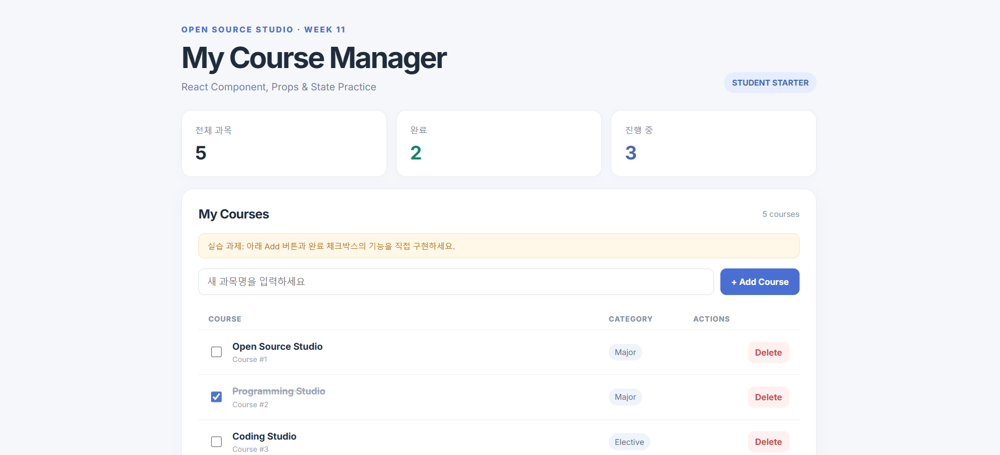

## Project Information :
프로젝트 : 수강하는 수업 리스트 프로그램<br>
주요 기능 : 수강하는 수업을 추가, 삭제할 수 있고 현재 수강 진행 중인지 또는 수강 완료했는 지를 표시할 수 있습니다. 그리고 수업 이름을 검색하는 기능을 추가하였습니다.

## Installation :
깃허브에서 fork 진행 후 클론을 하였습니다. 그리고 과제 레포지토리와 연결하였습니다.<br>
그 후 npm install 과 npm run dev를 하여 실행하였습니다

실행화면 : 

## Source Code Exploration :
CourseList.jsx : 과목의 목록을 관리하는 파일으로 과목을 추가하고 삭제하는 기능, 수강 여부를 보여주는 기능 등이 있습니다. 그리고 검색 기능을 추가하였습니다.

CourseItem.jsx : 개별 과목을 화면에 보여주는 파일으로 CourseList로 부터 props를 전달받아 체크박스, 삭제 등을 표시합니다.

courses.js : 초기 과목 데이터들로 과목 이름, 카테고리, ID 등이 있습니다.

Component와 Props 관계 : CourseList는 전체 과목을 관리하는 부모 컴포넌트이고 CourseItem은 부모 컴포넌트로부터 props를 받는 자식 컴포넌트입니다. props는 컴포넌트 사이에서 데이터나 함수를 주고 받을 때 사용하는 것으로 부모 컴포넌트로부터 과목 정보, 삭제 함수 등을 받습니다.

useState 및 Event 분석 : useState를 이용해서 상태를 관리하고 setCourses를 이용해서 과목 추가, 삭제 등 변화한 결과를 가진 새로운 배열로 상태를 업데이트합니다. 클릭을 해서 onClick 이벤트가 발생하면 onDelete인 handleDelete 함수가 실행되고 filter를 이용해서 새로운 배열을 만들고 그 배열로 상태를 업데이트합니다.

주요 코드 2개 설명 :<br>
handleAdd : preventDefault() 를 이용해서 새로고침을 막고 입력값이 비어있으면 종료합니다. 새로운 과목을 객체로 만들고 배열에 추가하여 상태를 업데이트합니다. 그 후 ID를 하나 증가해서 업데이트 해주고 입력창을 비워줍니다.<br>
handleToggle : map을 이용해서 모든 과목을 확인하면서 id가 맞으면 해당 id의 completed를 반전시켜서 상태를 업데이트합니다

## Customizing :
데이터에 컴퓨터 구조, 자바 프로그래밍, 시스템 프로그래밍 등을 추가하였습니다. 제목을 MY 수업 관리 프로그램으로 변경하고 아래 소개글도 My Courses for Computer Science로 변경하였습니다. 그리고 스타일을 다크 모드로 변경하였습니다.

## Feature Extension :
과목 추가 기능을 추가하였고 수강 중과 수강 완료 상태를 변경하는 기능을 추가하였습니다. 또 검색 기능을 추가하였습니다.<br>
setCourses((previous) => [...previous, newCourse]);<br>
새로운 과목을 배열에 추가해서 상태를 업데이트합니다.<br>
return { ...course, completed: !course.completed };<br>
다른 정보는 유지하고 수강 상태를 반전 시켜서 배열에 넣고 상태를 업데이트합니다.<br>
course.name.toLowerCase().includes(Search.toLowerCase())<br>
소문자로 모두 변환시키고 포함한 과목만 보여줍니다.

## Deployment :
https://week11-project-beryl.vercel.app/

## Weekly Review :
1. 새롭게 배운 내용 3가지
- useState, setCourses 등을 이용해서 상태를 관리(추가, 삭제)하는 방법에 대해 배울 수 있었습니다.
- props로 부모 컴포넌트로부터 데이터나 함수를 전달받는 것을 배울 수 있었습니다.
- spread를 이용해서 기본 배열 데이터를 유지하고 새로운 정보를 추가하는 방법을 배울 수 있었습니다.
2. 어려웠던 점과 해결 방법
- 검색 기능을 구현하는 부분에서 어려움이 있었습니다. 포함되어 있는 단어의 과목만 남기고 새로운 배열을 만들고 그 배열을 보여줌으로 해결하였습니다.
3. AI 활용 내용 및 느낀점
- 이번 과제를 진행하는데 필요한 개념에 대해 설명 받는 시간을 가졌습니다. 또 중간에 코드가 안 돌아갈 경우 코드에 대한 문제점을 발견해주는 시간도 가졌습니다. 이를 통해 코드를 짜는 데 Ai한테 많은 도움을 받을 수 있다는 것을 느꼈습니다.


<hr>

# OSS Week 11 — React Course Manager (Student Starter)

React + Vite 기반 학생 배포용 Sample Project입니다. **조회와 삭제는 완성**, 등록 및 완료 변경은 학생이 직접 구현하도록 `TODO`로 남겨두었습니다.

## 실행 방법

Node.js 20.19+ 또는 22.12+ 권장.

```bash
npm install
npm run dev
```

브라우저에 표시되는 Local URL에 접속하세요. 빌드 테스트: `npm run build`.

## 소스 구조

- `src/App.jsx`: 페이지 전체 레이아웃
- `src/components/CourseList.jsx`: State 및 목록, 삭제 로직, **TODO 1/2**
- `src/components/CourseItem.jsx`: Props로 데이터를 받고 이벤트 콜백 호출
- `src/data/courses.js`: 초기 과목 데이터
- `src/App.css`: 전체 디자인

## 수행 내용

1. 코드를 실행하고 목록 조회·삭제를 확인합니다.
2. 초기 과목 5개 이상, 제목, CSS 3곳 이상 변경합니다.
3. `CourseList.jsx`의 **TODO 1**: 과목 등록 (빈 값 입력 방지, 고유 id 지정, State 업데이트).
4. `CourseList.jsx`의 **TODO 2**: 완료 체크박스 클릭 시 `completed` 상태 변경.
5. 선택: 검색/필터, 이름 수정 기능 추가.
6. GitHub에 Commit/Push 후 Vercel에 배포합니다.
7. README에 프로젝트 소개, 주요 코드 분석 2개, 변경 내용, Weekly Review, GitHub URL, Vercel URL을 정리합니다.

## 확인할 질문

- `CourseList`와 `CourseItem`의 역할은?
- 왜 `courses`를 직접 수정하지 않고 `setCourses()`를 사용할까요?
- `map()`과 `filter()`는 각각 어떤 목적인가요?
- `course`, `onDelete`, `onToggle` Props는 어디에서 전달되나요?
- 브라우저 새로고침 시 데이터가 초기화되는 이유는? (DB/localStorage 없음)

> 교육 목적의 로컬 State 앱입니다. 서버 API 및 데이터베이스는 사용하지 않습니다.
